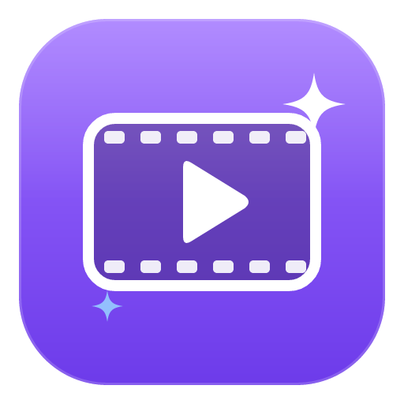
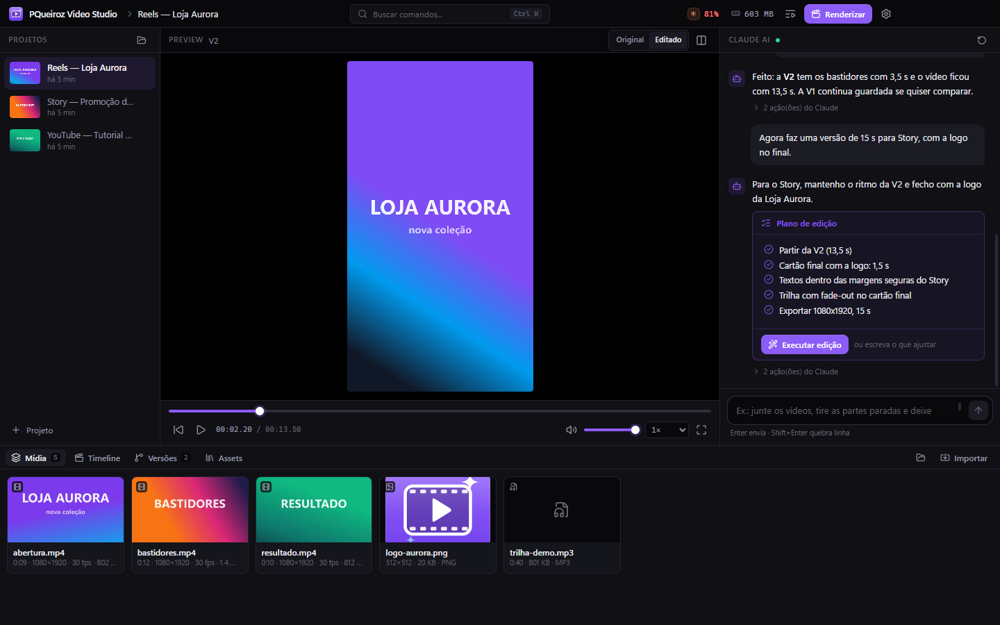
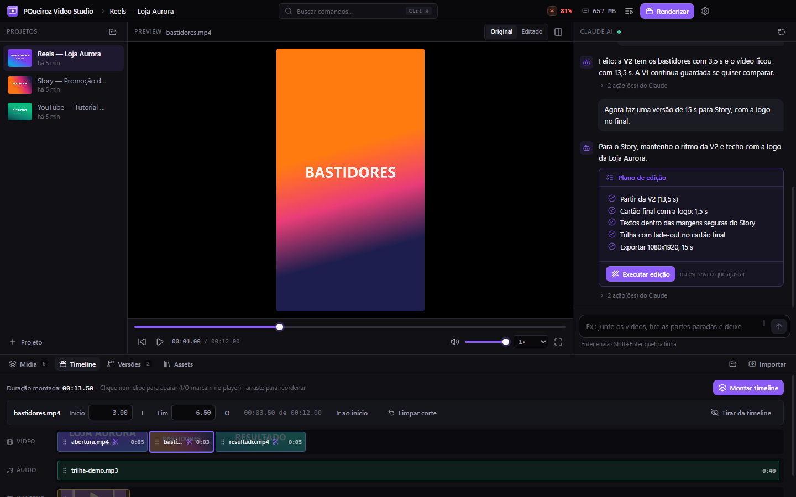
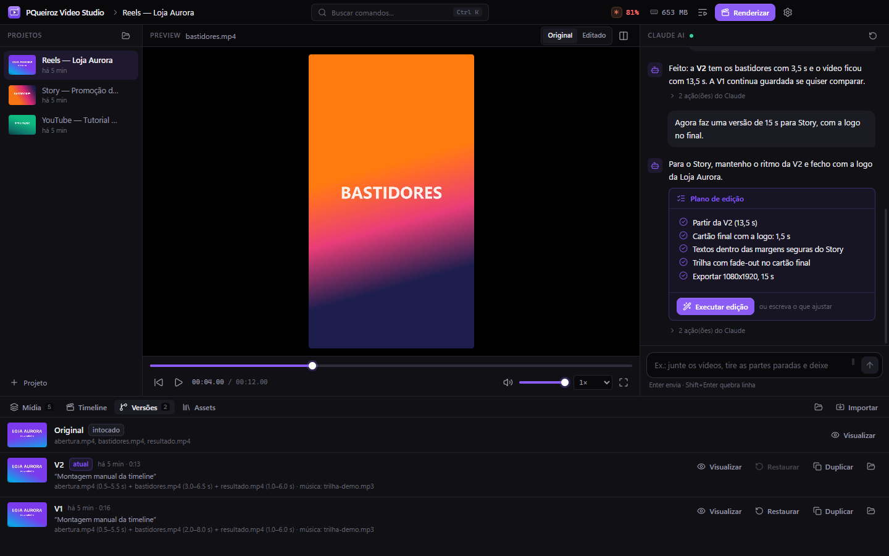
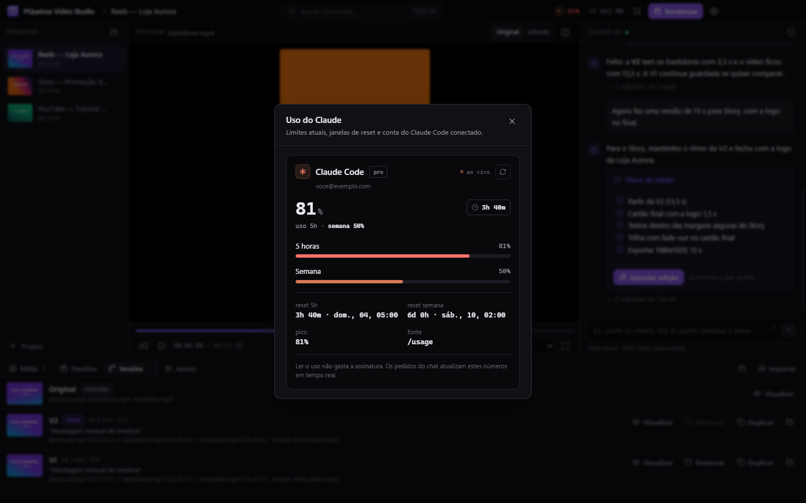
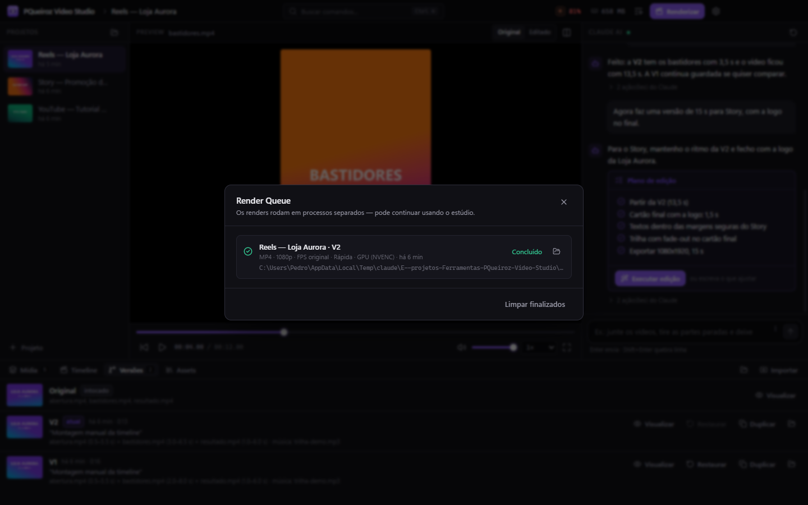
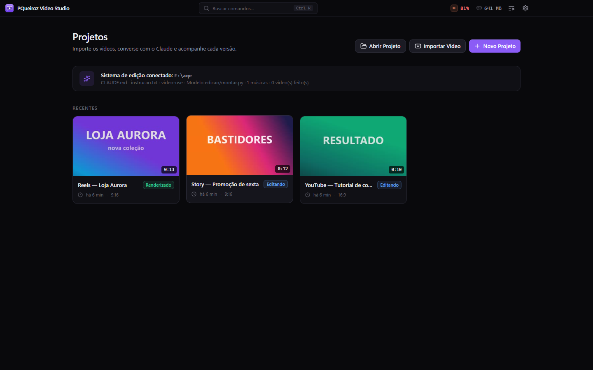
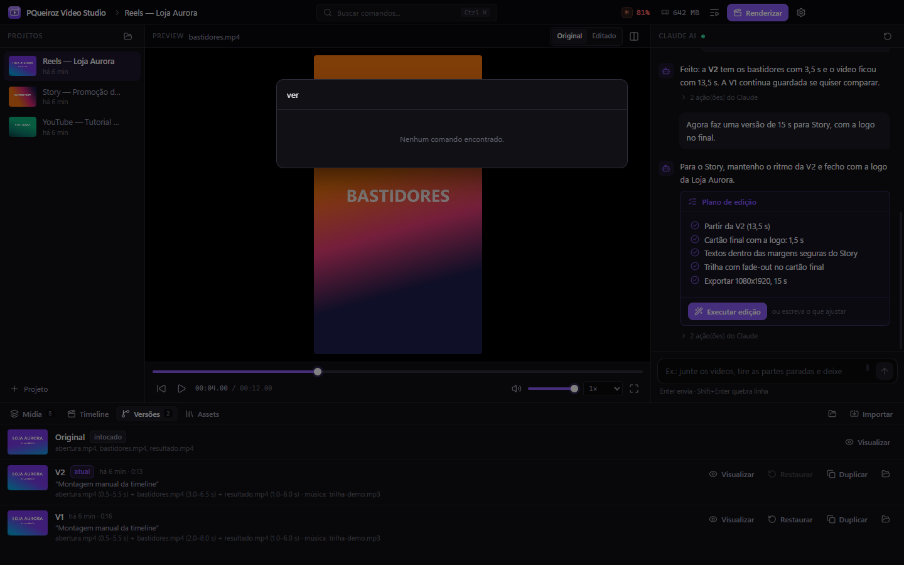

<div align="center">



# PQueiroz Video Studio

**Edição de vídeo conversando com o Claude.**<br>
Importe os clipes, peça a edição em português e acompanhe cada versão, do preview ao render.

[](https://github.com/PQueirozDev/PQueiroz-Video-Studio/releases/latest)
[](https://github.com/PQueirozDev/PQueiroz-Video-Studio/releases)
[](https://github.com/PQueirozDev/PQueiroz-Video-Studio/releases/latest/download/PQueiroz-Video-Studio-Setup.exe)
[](LICENSE)

[**⬇ Baixar para Windows**](https://github.com/PQueirozDev/PQueiroz-Video-Studio/releases/latest/download/PQueiroz-Video-Studio-Setup.exe) ·
[**⬇ Linux (.AppImage)**](https://github.com/PQueirozDev/PQueiroz-Video-Studio/releases/latest/download/PQueiroz-Video-Studio.AppImage) ·
[Linux (.deb)](https://github.com/PQueirozDev/PQueiroz-Video-Studio/releases/latest/download/PQueiroz-Video-Studio.deb) ·
[Site](https://pqueirozdev.github.io/PQueiroz-Video-Studio) ·
[Novidades](https://github.com/PQueirozDev/PQueiroz-Video-Studio/releases)

<br>



</div>

<br>

O Video Studio é a interface gráfica de um fluxo de edição que já funciona no terminal: o
**Claude Code** lê as regras do seu `CLAUDE.md`, usa os seus scripts (FFmpeg, Python) e entrega o vídeo.
O app organiza projetos, mostra o que o Claude está fazendo, guarda cada resultado como uma versão
e renderiza o final. Tudo roda no seu PC, com a sua assinatura do Claude e sem API key.

## Telas

<table>
  <tr>
    <td width="50%"><p align="center"><b>Timeline</b> · aparar com I/O, reordenar e montar uma versão</p></td>
    <td width="50%"><p align="center"><b>Versões</b> · V1, V2… com o pedido de cada uma; o original nunca muda</p></td>
  </tr>
  <tr>
    <td><p align="center"><b>Uso do Claude</b> · janelas de 5 h e da semana, ao vivo</p></td>
    <td><p align="center"><b>Render</b> · fila com progresso real, GPU com fallback para CPU</p></td>
  </tr>
  <tr>
    <td><p align="center"><b>Projetos</b> · miniatura, duração, status e última modificação</p></td>
    <td><p align="center"><b>Ctrl K</b> · comandos, projetos e versões pelo teclado</p></td>
  </tr>
</table>

## Como funciona

```
Você ──► chat do Video Studio ──► Claude Code (sua assinatura)
                                     │  lê CLAUDE.md, instruções e skills do seu fluxo
                                     ▼
                          scripts do fluxo (montar.py, FFmpeg)
                                     ▼
            output/ ──► nova versão (V1, V2…) ──► preview ──► render
```

- **Chat com plano de edição.** Para pedidos grandes o Claude propõe um plano; o botão *Executar edição* aprova.
- **Status ao vivo.** "Analisando os vídeos...", "Processando áudio...", "Renderizando prévia..." a partir das ferramentas que o Claude usa.
- **Versões automáticas.** Todo vídeo novo em `output/` vira uma versão imutável, com o pedido e o resumo do Claude. Visualizar, restaurar e duplicar.
- **Uso do Claude na barra de título**, como no [Qyrex](https://github.com/PQueirozDev/Qyrex): lido com `claude -p /usage` (não gasta uso) e atualizado pelos eventos de limite do próprio chat.
- **Timeline** com cortes não destrutivos (I/O), trilha de áudio e *Montar timeline*.
- **Presets** (Reel rápido, Reel profissional, Story, YouTube, Antes e Depois…) e presets próprios com instruções para o Claude.
- **Biblioteca de assets** compartilhada: logos, músicas, fontes, overlays, intros e finalizações.
- **Proxies** 540p automáticos para vídeos 4K, HEVC ou pesados (só no preview).
- **Render** em MP4/MOV, 1080p a 4K, NVENC com fallback para CPU, fila sem travar a interface.
- **Atualização automática** pelo GitHub Releases.

## Segurança

- Os arquivos originais nunca são alterados: a importação copia, e nada é sobrescrito (nomes repetidos ganham ` (2)`).
- A pasta do fluxo original é somente leitura. Correções necessárias (caminhos antigos, FFmpeg 9) são aplicadas **na cópia** de cada projeto.
- Processos rodam com `spawn`, argumentos em lista e sem shell. Comandos destrutivos (`rm -rf`, `del`, `Remove-Item`…) ficam bloqueados para o Claude.
- `contextIsolation`, CSP restritiva e um protocolo de mídia que só serve arquivos das pastas do estúdio.

## Requisitos

- Windows 10/11 (x64) ou Linux x64 (AppImage ou .deb para Ubuntu/Debian)
- [Claude Code](https://docs.claude.com/claude-code) instalado e logado (`claude`)
- [FFmpeg](https://www.gyan.dev/ffmpeg/builds/) no PATH (Windows: `winget install Gyan.FFmpeg` · Linux: `sudo apt install ffmpeg`)
- Opcional: Python com librosa, numpy e Pillow para fluxos baseados em script — o onboarding verifica tudo e mostra o que falta.

## Desenvolvimento

```powershell
git clone https://github.com/PQueirozDev/PQueiroz-Video-Studio
cd PQueiroz-Video-Studio
npm install
npm run dev        # Vite + Electron com hot reload
npm run typecheck
npm run dist       # instalador em dist/
```

Electron · React 19 · TypeScript · Vite · Tailwind CSS 4 · Zustand · SQLite (`node:sqlite`) · FFmpeg · Claude Code

```
src/
  shared/     tipos e contrato da API (main ⇄ interface)
  main/       Electron: projetos, mídia, Claude, versões, render, assets, banco
  preload/    ponte segura com contextIsolation
  renderer/   React: dashboard, player, chat, timeline, configurações
site/         site do projeto (Vercel)
```

## Licença

[MIT](LICENSE) © 2026 Pedro Queiroz
